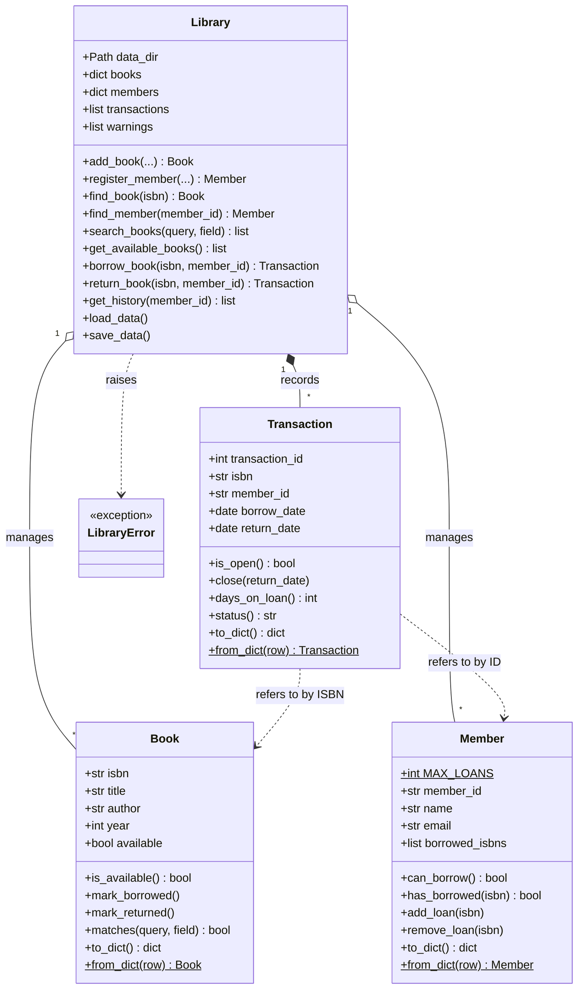

# Library Management System

A menu-driven, object-oriented command-line application for managing a small library's books, members, loans and returns. All data is saved in CSV files, so nothing is lost when the program is closed.

Developed for **B100: Introduction to Computer Programming with Python** at Gisma University of Applied Sciences.

---

## 1. Project description

The application lets a librarian keep a catalogue of books, register members, lend books, accept returns and look up the full borrowing history. It is written in plain Python using only the standard library, and is split into small modules with one responsibility each.

## 2. Problem being addressed

Small libraries, such as a school, department or community library, often track loans in a notebook or a single spreadsheet. This leads to typical problems:

- nobody knows for certain whether a book is on the shelf;
- the same book can be lent twice;
- returns are recorded against the wrong person, or not at all;
- there is no reliable history of who borrowed what and when.

This system enforces the library's rules automatically (a book can only be on loan once, members have a loan limit, only the borrower can return a book) and keeps a permanent, dated record of every loan.

## 3. Main features

| Feature | Details |
|---|---|
| Book catalogue | Add books with ISBN, title, author and year; list all or only available books |
| Search | By title, author, ISBN or any field; case-insensitive, partial matches (e.g. `pyth`) |
| Members | Register members with ID, name and email; list members and their current number of loans |
| Borrowing | Checks that the book and member exist, the book is available and the member is under the 3-book limit |
| Returning | Only the member who borrowed the book can return it; loan length in days is shown |
| History | Every loan is a numbered transaction with borrow and return dates; filter by member |
| Validation | Required fields, ISBN format (10 or 13 digits, hyphens allowed), realistic year, email format, duplicate ISBNs and member IDs |
| Persistence | Saved to CSV after every change; reloaded on start-up |
| Robust loading | Missing files are created, empty files are accepted, invalid rows are skipped with a warning and the original file is backed up as `.bak` |
| Error handling | Invalid input never crashes the program; clear messages are shown and the menu returns |

## 4. Technologies used

- **Python 3.8+** (developed and tested with Python 3.13)
- Standard library only: `csv`, `datetime`, `pathlib`, `shutil`, `sys`
- `unittest` and `tempfile` for automated testing
- `pycodestyle` and `pyflakes` (optional) for PEP 8 and code checks

## 5. Repository structure

```
LibraryManagementSystem/
├── main.py              # Menu-driven user interface (entry point)
├── library.py           # Library class: business rules + LibraryError
├── book.py              # Book class
├── member.py            # Member class
├── transaction.py       # Transaction class
├── storage.py           # CSV reading/writing helpers
├── validation.py        # Shared input-validation functions
├── data/
│   ├── books.csv
│   ├── members.csv
│   └── transactions.csv
├── tests/
│   ├── __init__.py
│   └── test_library.py  # 33 unittest test cases
├── docs/
│   ├── PROJECT_GUIDE.md # Design notes, compliance matrix, checklist
│   └── demo_session.txt # Recorded output of a full program run
├── report/
│   └── assessment_report.md
├── README.md
├── requirements.txt
└── .gitignore
```

Two modules were added to the suggested structure: `storage.py` keeps all CSV code in one place, and `validation.py` holds validation rules shared by several classes. Both exist to avoid duplicated code.

## 6. Class design



## 7. Installation

1. Install Python 3.8 or newer from [python.org](https://www.python.org/downloads/). Check with:
   ```bash
   python --version
   ```
2. Clone or download the repository:
   ```bash
   git clone https://github.com/<your-username>/LibraryManagementSystem.git
   cd LibraryManagementSystem
   ```
3. No packages need installing (`requirements.txt` documents this).

## 8. Running the application

From the project folder:

```bash
python main.py
```

(On some macOS/Linux systems use `python3` instead of `python`.)

The data folder is located relative to `main.py`, so the program finds its CSV files from any working directory.

## 9. Example usage

Borrowing a book and trying to borrow it again:

```
Select an option (1-10): 6

--- Borrow a book ---
ISBN of the book: 9780132350884
Member ID: M004
Success: 'Clean Code' borrowed by M004 (transaction #3).

Select an option (1-10): 6

--- Borrow a book ---
ISBN of the book: 9780132350884
Member ID: M001
Error: 'Clean Code' is already on loan and cannot be borrowed.
```

Invalid input is handled without crashing:

```
--- Add a new book ---
ISBN: 9781234567897
Title: Test Book
Author: Someone
Publication year: abc
Invalid input: Publication year must be a whole number.

Select an option (1-10): abc
'abc' is not a valid option. Please enter a number from 1 to 10.
```

A full recorded session is in [`docs/demo_session.txt`](docs/demo_session.txt).

## 10. Sample menu output

```
Welcome to the Library Management System
Loaded 6 book(s), 3 member(s) and 2 transaction(s).

========== LIBRARY MENU ==========
 1. Display all books
 2. Add a new book
 3. Search for a book
 4. Register a library member
 5. Display all members
 6. Borrow a book
 7. Return a book
 8. View borrowing history
 9. View available books
10. Exit
Select an option (1-10): 1

--- Display all books ---
ISBN           Title                          Author                 Year  Status
---------------------------------------------------------------------------------
9780132350884  Clean Code                     Robert C. Martin       2008  Available
9780201633610  Design Patterns                Erich Gamma            1994  Available
9780134685991  Effective Java                 Joshua Bloch           2018  Available
9781491946008  Fluent Python                  Luciano Ramalho        2015  Available
9780262033848  Introduction to Algorithms     Thomas H. Cormen       2009  On loan
9781593279288  Python Crash Course            Eric Matthes           2019  Available
(6 record(s))
```

## 11. Testing

Run all 33 unit tests from the project folder:

```bash
python -m unittest -v
```

Expected final lines:

```
Ran 33 tests in 0.05s

OK
```

The tests cover adding books, registering members, searching, borrowing available and unavailable books, the loan limit, valid and invalid returns, duplicate records, invalid input, CSV persistence across a restart, missing/empty/corrupted files and the `.bak` backup. Each test uses a temporary folder, so `data/` is never modified by testing.

Optional style check:

```bash
pip install pycodestyle pyflakes
python -m pycodestyle *.py tests/*.py
python -m pyflakes *.py tests/*.py
```

## 12. Future improvements

- Due dates, overdue reports and fines.
- Editing and deleting books and members (with checks for active loans).
- Multiple copies of the same title.
- A start-up consistency check between `books.csv`, `members.csv` and `transactions.csv` (for files edited by hand).
- ISBN check-digit validation.
- An SQLite database for larger collections and safe concurrent use.
- A graphical interface (e.g. Tkinter) for non-technical staff.

## Author

[Your name] — Gisma University of Applied Sciences, B100 Introduction to Computer Programming with Python, [term/year].
