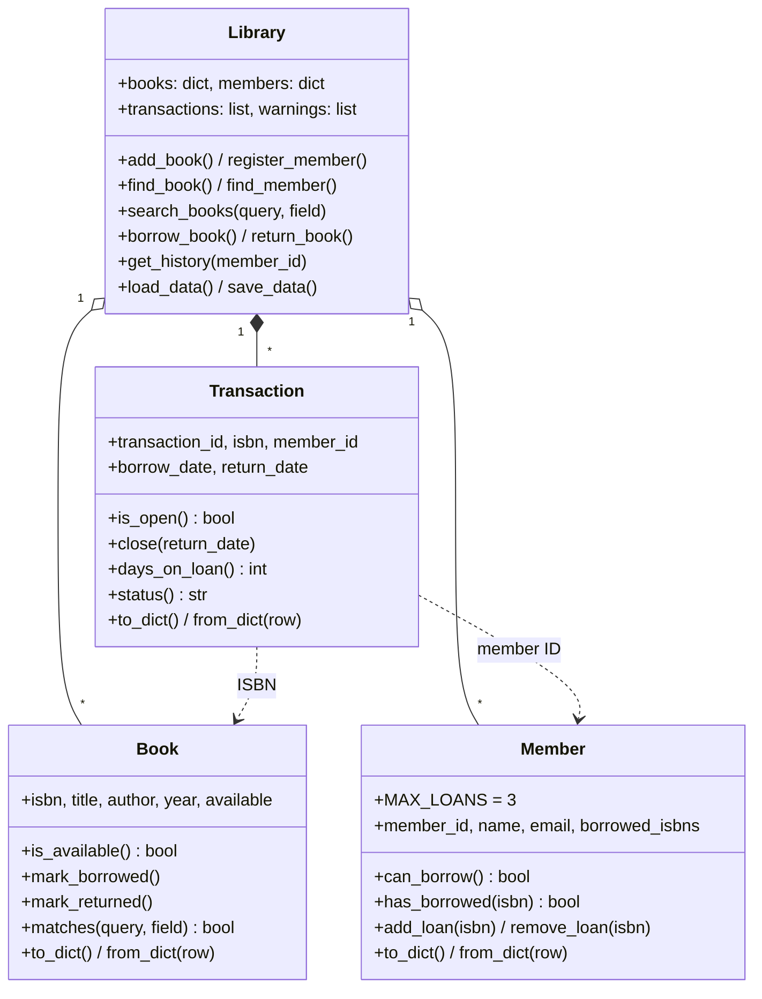

# Library Management System: Design, Implementation and Evaluation of a Menu-Driven Python Application

**Module:** B100 Introduction to Computer Programming with Python
**Institution:** Gisma University of Applied Sciences
**Student:** [KEITH RYAN BUKARA] ([GH1064424])
**Date:** [18/12/2026]
**Repository:** [https://github.com/ryanminds7-ui/LibraryManagementSystem]

---

## 1. Introduction

### 1.1 Organisation and problem

The organisation considered in this project is a small lending library, such as a university department library or a community reading room, run by one or two staff members. Libraries of this size frequently record loans in a paper ledger or a shared spreadsheet. Such records rely entirely on the discipline of the person updating them: nothing prevents a book from being recorded as lent twice, a return from being logged against the wrong person, or the record from becoming inconsistent with the shelves. The library also loses a reliable answer to simple questions such as "Is this book available?" or "What has this member borrowed before?".

### 1.2 Purpose and scope

The purpose of the application is to replace this informal record with a program that stores the catalogue, members and loans, and that **enforces the library's rules automatically** rather than relying on the user. The application allows a librarian to add books, register members, search the catalogue, lend and accept books, and view the borrowing history. All data is stored in CSV files so that it persists between sessions.

The scope was deliberately limited to the concepts of an introductory programming module. The application is a single-user, command-line program using only the Python standard library. Due dates, fines, multiple copies of a title and editing or deleting records are outside the scope and are discussed as future work in Section 5.

---

## 2. System Design

### 2.1 Architecture

The application follows a layered structure in which each module has a single responsibility (Table 1). The user interface never manipulates data directly; it calls methods on a `Library` object, which applies the rules and saves the result.

**Table 1. Modules and responsibilities**

| Module | Responsibility |
|---|---|
| `main.py` | Menu, user input, displaying results and error messages |
| `library.py` | `Library` class (business rules, coordination) and `LibraryError` |
| `book.py`, `member.py`, `transaction.py` | Domain classes holding data and their own state rules |
| `storage.py` | Reading and writing CSV files |
| `validation.py` | Validation rules shared by several classes |

Two modules were added to the structure suggested in the brief. `storage.py` was introduced because the CSV logic for three files would otherwise have been repeated inside `Library`, and `validation.py` because both `Book` and `Member` require the same "required text" rule, while `Library` must normalise ISBNs and member IDs in exactly the same way as the classes that create them. Placing each rule in one function guarantees that, for example, `978-1-59327-928-8` and `9781593279288` are always treated as the same ISBN.

### 2.2 Classes

Figure 1 shows the class design.

**Figure 1. UML class diagram (Mermaid)**



- **Book** stores the ISBN, title, author, year and an `available` flag. Its methods protect its own state: `mark_borrowed()` refuses to lend a book already on loan, and `matches()` implements case-insensitive partial search on one field or all fields.
- **Member** stores identity details and the list of ISBNs currently on loan. The class attribute `MAX_LOANS` expresses the library policy in one place, and `can_borrow()` and `has_borrowed()` answer the questions `Library` needs before lending or accepting a book.
- **Transaction** records one loan. A transaction is *open* while `return_date` is `None`; `close()` sets the return date and rejects a date earlier than the borrow date. `days_on_loan()` derives the loan length rather than storing it, avoiding a value that could become inconsistent.
- **Library** owns the three collections and coordinates every operation. Books and members are stored in dictionaries keyed by ISBN and member ID, which makes look-up direct and makes duplicate detection a simple membership test. Transactions are kept in a list because their order is meaningful as a history.

Every domain class has at least four meaningful methods (Book, Member and Transaction each have seven besides `__init__`; Library has eighteen). Each also provides `to_dict()` and the class method `from_dict()`, so each object is responsible for converting itself to and from a CSV row.

### 2.3 Relationships

`Library` aggregates `Book` and `Member` objects and composes `Transaction` objects, which only exist as part of the library's history. A `Transaction` refers to a book and member by **identifier** rather than by object reference. This was a deliberate choice: identifiers can be written directly into a CSV file and resolved again when the data is loaded, whereas object references cannot be stored in a flat file.

### 2.4 Data management

Data is held in three CSV files with header rows. Members' current loans are stored as ISBNs separated by semicolons in one cell, and dates use ISO format (`YYYY-MM-DD`), which `datetime.date.fromisoformat()` reads directly.

The application saves all three files after every successful change rather than only on exit. This costs a small amount of unnecessary writing, but means that closing the terminal or pressing Ctrl+C can never lose a completed operation; with the expected data size the cost is negligible. A consequence of this design is that the in-memory objects are the single working copy, and the files are rewritten from them.

---

## 3. Implementation Overview

### 3.1 Object-oriented programming

Objects are created both from user input (`Library.add_book()` constructs a `Book`) and from stored data (`Book.from_dict()`). The classes interact through a clear sequence in `borrow_book()`: `Library` asks `find_book()` and `find_member()` for the objects, checks `book.is_available()` and `member.can_borrow()`, creates a `Transaction`, then tells the book and member to update themselves. Validation in constructors means an invalid object can never exist, so later code does not need to re-check fields.

### 3.2 Functions and modular programming

`main.py` contains one short function per menu option. These are stored in a dictionary, `MENU_OPTIONS`, mapping each menu number to a label and a function. The same dictionary is used both to print the menu and to choose the action, so adding an option requires changing only one place, and the menu loop contains no long `if/elif` chain. Helper functions such as `prompt_text()` and `print_table()` remove repetition from the menu functions.

### 3.3 Loops and conditional statements

A `while True` loop drives the menu until option 10 is chosen, and `prompt_text()` uses a `while` loop to repeat a question until a non-blank answer is given. `for` loops are used to load CSV rows, print tables and search for an open transaction. List comprehensions, a compact form of `for` loop, filter available books and member histories. `if/elif/else` statements make the main decisions: which search field to use in `Book.matches()`, and whether a loan is refused because the book is unavailable or because the member has reached the limit.

### 3.4 File handling

`storage.load_rows()` uses `csv.DictReader`, so code refers to columns by name instead of position. Three file situations are handled explicitly: a **missing** file is created with a header; an **empty** file produces an empty collection; and a file **missing required columns** raises a `ValueError` that `main()` reports before exiting cleanly. Files are opened with `with` statements so they are closed even if an error occurs, and `pathlib` locates the `data` folder relative to `main.py`, so the program works regardless of the directory it is started from.

### 3.5 Exception handling

The design distinguishes two kinds of error. `ValueError` signals **invalid data**, such as a blank title or a year of "abc". The custom `LibraryError` signals a **valid request that breaks a rule**, such as borrowing a book already on loan. The menu loop catches `LibraryError`, `ValueError` and `OSError` separately and prints a specific message, then shows the menu again. Exceptions are therefore raised close to where a problem is detected but handled in one place, the user interface, which keeps the classes free of `print()` calls and makes them testable. In `validation.py`, `raise ... from None` replaces Python's technical message ("invalid literal for int()") with one a librarian can understand. `KeyboardInterrupt` and `EOFError` are caught in `main()` so that Ctrl+C ends the program politely.

Rule checks happen *before* any state is modified. In `borrow_book()`, the transaction is created and all checks pass before the book and member are changed, so a refused request leaves the data untouched.

---

## 4. Testing and Demonstration

### 4.1 Strategy

Correctness was evaluated in three ways:

1. **Automated unit tests** (`tests/test_library.py`) using `unittest`: 33 tests in seven test classes covering each domain class on its own, then the `Library` operations and persistence. Each test creates a fresh library in a temporary directory, so tests are independent and never modify the real data.
2. **Scripted end-to-end runs** of `main.py` with prepared input, recorded in `docs/demo_session.txt`, followed by a restart to confirm persistence.
3. **Static checks** with `pycodestyle` (PEP 8) and `pyflakes` (unused imports and undefined names), which reported no issues.

Dates are passed as parameters to `borrow_book()` and `return_book()` in tests, so results such as "7 days on loan" are predictable rather than depending on the day the tests run.

### 4.2 Test cases and results

All tests were executed on 16 November 2026 with Python 3.13; the suite reported `Ran 33 tests ... OK`. Table 2 summarises representative cases.

**Table 2. Selected test cases (expected and actual results)**

| # | Scenario | Input | Expected | Actual |
|---|---|---|---|---|
| T1 | Add book with hyphenated ISBN | `978-1-59327-928-8` | Stored as `9781593279288` | Pass |
| T2 | Duplicate ISBN in different format | Same ISBN with hyphens | `LibraryError`; still one book | Pass |
| T3 | Duplicate member ID, different case | `m001` after `M001` | `LibraryError` | Pass |
| T4 | Invalid fields | Blank title, year `"twenty"`, year 3000, email `not-an-email` | `ValueError`; nothing saved | Pass |
| T5 | Search by each field | `clean`/title, `matthes`/author, `9780132`/ISBN | Exactly the matching book | Pass |
| T6 | Invalid search | Blank term; field `publisher` | `ValueError` | Pass |
| T7 | Borrow available book | Python Crash Course, M001 | Transaction #1; book unavailable; member holds ISBN | Pass |
| T8 | Borrow unavailable book | Same book, M002 | `LibraryError`; still one transaction | Pass |
| T9 | Loan limit | Fourth loan for M001 | `LibraryError` | Pass |
| T10 | Valid return | Borrowed 1 Nov, returned 8 Nov | 7 days; book available again | Pass |
| T11 | Return not borrowed / wrong member | M002 returns M001's book | `LibraryError`; book stays on loan | Pass |
| T12 | Persistence | Borrow, return, create new `Library` from same folder | Books, loans and return dates identical | Pass |
| T13 | Missing / empty files | No files; zero-byte files | Files created; empty collections | Pass |
| T14 | Corrupted rows | Invalid ISBN row and duplicate ISBN row | Rows skipped with warnings; `.bak` created | Pass |

### 4.3 Demonstration of error handling

The recorded session confirms that each error reaches the user as a readable message and that the program continues. Extracts:

```
Publication year: abc
Invalid input: Publication year must be a whole number.

ISBN of the book: 9780132350884
Member ID: M001
Error: 'Clean Code' is already on loan and cannot be borrowed.

ISBN of the book: 9780132350884
Member ID: M001
Error: Anna Schmidt (M001) does not have 'Clean Code' on loan.

Select an option (1-10): abc
'abc' is not a valid option. Please enter a number from 1 to 10.
```

After exiting and restarting, the program reported `Loaded 7 book(s), 4 member(s) and 3 transaction(s)`, reflecting the book, member and loan added in the first session, and the member list showed M004 with one loan.

### 4.4 Bug discovered and corrected

All unit tests passed on their first execution, which in itself was a warning sign that the tests might be checking only expected behaviour. Additional manual tests with deliberately damaged files revealed a genuine defect. When `books.csv` contained an invalid row, the program correctly skipped it with a warning; however, the next save rewrote the file from the objects in memory, so the skipped row was **permanently deleted** without the user being told. This was reproduced by loading a file with an invalid ISBN, registering a member and observing that the row had disappeared from the file.

The fix copies the original file to `books.csv.bak` (or the equivalent for the other files) before it can be overwritten, and adds a warning naming the backup. The same treatment was applied to rows ignored as duplicates. A regression test, `test_backup_is_made_before_invalid_rows_are_lost`, now checks that the backup exists and contains the original text. This episode showed that tests written alongside the code tend to share the author's assumptions, and that deliberately trying to break the program found a problem that the planned tests did not.

---

## 5. Reflection

### 5.1 Technical challenges and solutions

**Keeping three representations consistent.** A loan changes three things at once: the book's `available` flag, the member's list of loans and the transaction history. The main challenge was ensuring these never disagreed after a refused operation. This was solved by performing all checks first and only then changing state, and by tests that assert the state is unchanged after each rejected request (T8, T11).

**Deciding where validation belongs.** Validating inside the menu would have been simpler but would have allowed invalid objects to be created by tests or by loading a file. Validating in the constructors, using shared functions, means the same rules apply to typed input and to CSV data.

**Errors versus messages.** An early temptation was to print error messages inside the classes. Raising exceptions instead and printing them only in `main.py` made the classes testable with `assertRaises` and kept the user interface in one module.

### 5.2 What I learned

[*This was my first Python project, and building a complete application
taught me far more than working on separate exercises. The parts I found
most difficult were the CSV files and the error messages. Saving objects
to a file and loading them again was harder than I expected, because the
data has to be converted to text when it is saved and back into objects
when the program starts. Error handling was also challenging at first,
as it was not obvious to me where an error should be detected and where
the message should be shown to the user. Working through these parts
step by step improved my understanding of how the different files and
classes of a program fit together.

This was also my first time using Git and GitHub. The process felt
confusing at first, but I quickly became comfortable with saving my work
in commits and uploading it to an online repository, which I now see as
an important part of developing software professionally.*]

### 5.3 Limitations

- **No cross-file consistency check.** Each file is validated on its own. If the CSV files are edited by hand so that a member lists a loan the books file marks as available, the program will not detect the contradiction, and the book could be lent twice.
- **Non-atomic saving.** Files are rewritten one after another. A failure part-way through (for example, a full disk) could leave them out of step. The error is reported, but not rolled back.
- **Simplified domain.** There are no due dates or fines, one record represents one physical copy, and books and members cannot be edited or removed.
- **Basic validation.** ISBN check digits are not verified and the email check only confirms a plausible format.
- **Single user.** Two people running the program on the same files at the same time could overwrite each other's changes.

### 5.4 Future improvements

The most valuable next steps follow directly from these limitations: a start-up consistency check that compares loans across the three files; writing to temporary files and renaming them so a save is all-or-nothing; due dates with an overdue report; and editing or removing records with protection against deleting a member who still holds books. For a larger library, moving from CSV to SQLite (included in the standard library) would provide transactions and safe concurrent access while keeping the class design largely unchanged, since the storage logic is already isolated in one module.

### 5.5 Conclusion

The project delivers a working library system that satisfies the brief using core Python concepts: classes, loops, conditionals, file handling, exceptions and modules. Its main strength is that library rules are enforced by the program rather than by the user, and that these rules are verified by an automated test suite. Its main weakness is that the CSV files are trusted to be consistent with one another, which is acceptable for a single-user tool but would need addressing before wider use.

---

## References

Python Software Foundation (n.d.) *csv — CSV File Reading and Writing*. Available at: https://docs.python.org/3/library/csv.html (Accessed: [23 November 2026]).

Python Software Foundation (n.d.) *Errors and Exceptions* (The Python Tutorial). Available at: https://docs.python.org/3/tutorial/errors.html (Accessed: [23 November 2026]).

Python Software Foundation (n.d.) *unittest — Unit testing framework*. Available at: https://docs.python.org/3/library/unittest.html (Accessed: [23 November 2026]).

van Rossum, G., Warsaw, B. and Coghlan, N. (2001) *PEP 8 – Style Guide for Python Code*. Available at: https://peps.python.org/pep-0008/ (Accessed: [23 November 2026]).

---

## Declaration of AI Assistance

[**Student to complete according to Gisma's policy on generative AI.** State which tools were used, for which parts of the work (for example design, code, testing, report drafting), and how you reviewed and verified the output.]
